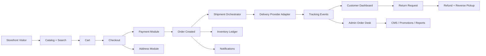

# Ecommerce Productization Report

## 1. Current Verdict

This repository is a **good boutique-store prototype**, not yet a **sellable ecommerce product** for reuse across multiple clothing brands.

What already exists:

- Storefront: home, listing, product detail, cart, checkout, auth
- Customer account: profile, orders, wishlist, notifications, custom design requests
- Admin panel: overview, products, variants, inventory, orders, coupons, reviews, customers
- Supabase schema: products, categories, orders, order items, cart, wishlist, reviews, custom designs, notifications, variants
- Edge functions: order notification insertion, low stock notification insertion

What blocks sellable-product readiness:

- No real payment gateway flow
- No shipment lifecycle model
- No courier/aggregator integration abstraction
- No returns/refunds workflow
- No customer address book / multi-address checkout
- No CMS / brand settings / SEO controls
- No analytics, audit trail, webhook ingestion, or operational logs
- No strong testing baseline
- Current UI is brand-specific to `Virasat`, not reusable

## 2. Frontend Gap Audit

### P0

- Rebrandable design system and theme settings
- Public CMS-managed pages: home, collections, about, shipping, returns, privacy, terms, contact
- Better PLP/PDP commerce UX: breadcrumbs, stock by variant, delivery ETA, reviews filters, recently viewed, sticky buy box, size recommendation
- Checkout split into delivery, payment, review, confirmation
- Order detail page with shipment timeline and invoice download
- Customer address book and saved addresses
- Admin order detail screen with payment + shipment + return context
- Admin settings area for logo, brand colors, banners, policies, contact info, SEO

### P1

- Advanced search, filter chips, sort presets, saved filters
- Collections landing pages and curated merchandising
- Personalization blocks: recommended, similar styles, frequently bought together
- Offer engine widgets: cart offer, upsell, free-shipping progress, bundle discounts
- Support/ticket center in dashboard
- Better accessibility: focus states, keyboard traps, live regions, reduced motion handling, form errors

### P2

- Loyalty / points / wallet
- Gift cards
- Wholesale / B2B inquiry flows
- WhatsApp commerce widgets
- Wishlist share
- Style quiz / fit assistant

## 3. Backend Gap Audit

### P0

- Payment order + payment transaction tables
- Shipment + shipment event tables
- Delivery provider abstraction
- Order status history
- Customer address book
- Returns / refund request workflow
- Inventory movement ledger
- Webhook event storage and replay
- Store settings / content settings

### P1

- Collections module
- Support tickets
- Audit logs
- Role expansion beyond `admin` / `user`
- Analytics event ingestion
- Segmentation / campaign primitives

### P2

- Subscription/maintenance contract tracking
- Wholesale pricing / MOQ / quote flows
- Marketplace connector sync logs
- ERP / WMS integration adapters

## 4. Recommended Monolith Shape

Use a **modular monolith**:

- `web-storefront`
- `customer-account`
- `admin-operations`
- `catalog`
- `pricing-promotions`
- `checkout`
- `payments`
- `fulfillment`
- `returns`
- `crm-support`
- `cms-branding`
- `analytics-reporting`
- `platform-admin`

### Module Tree

```text
app/
├── storefront/
│   ├── home-cms
│   ├── collections
│   ├── product-listing
│   ├── product-detail
│   ├── search
│   └── content-pages
├── customer/
│   ├── auth
│   ├── profile
│   ├── addresses
│   ├── orders
│   ├── returns
│   ├── wishlist
│   ├── notifications
│   └── support
├── commerce/
│   ├── catalog
│   ├── collections
│   ├── cart
│   ├── checkout
│   ├── coupons
│   ├── pricing
│   ├── custom-design
│   └── reviews
├── operations/
│   ├── payments
│   ├── shipments
│   ├── delivery-providers
│   ├── inventory
│   ├── returns
│   ├── order-management
│   └── webhooks
├── admin/
│   ├── dashboard
│   ├── products
│   ├── customers
│   ├── orders
│   ├── promotions
│   ├── cms
│   ├── reports
│   ├── settings
│   └── access-control
└── platform/
    ├── store-settings
    ├── maintenance-contracts
    ├── support-tickets
    └── audit-logs
```

## 5. Flow Graph



## 6. Delivery Recommendation

Recommended approach for this project:

1. Build your own **delivery abstraction layer** inside the monolith.
2. Start with **one aggregator integration** for speed.
3. Keep provider credentials and webhook mapping inside admin settings.

Practical choice:

- Default: `Shiprocket` for faster SMB onboarding, multi-carrier shipping, branded tracking, and easier panel-driven operations
- Upgrade path: `Delhivery` direct integration for higher-volume brands that want more control and deeper logistics workflows

Rule:

- The client should manage courier account/billing.
- Your app should only orchestrate order sync, label creation, tracking sync, NDR updates, and customer tracking UI.

## 7. Recurring Revenue Add-ons

These are the maintenance features that justify yearly or quarterly AMC:

- Payment gateway monitoring and webhook support
- Logistics connector maintenance
- OMS and shipment SLA dashboards
- SEO and landing-page operations
- Offer/campaign setup
- Analytics reporting
- Backup / incident / access audit review
- Monthly conversion optimization
- WhatsApp / email notification automation
- Return and RTO reduction optimization

Suggested sellable tiers:

- `Launch AMC`
- `Growth AMC`
- `Scale AMC`

## 8. Migration Roadmap

### Phase 1

- Add store settings
- Add customer addresses
- Add payment tables
- Add shipment tables
- Add order status history
- Add inventory movement ledger

### Phase 2

- Add returns module
- Add collections module
- Add support tickets
- Add webhook event storage
- Add audit logs

### Phase 3

- Add maintenance plans / contracts
- Add advanced reporting primitives
- Add campaign and segmentation layer

## 9. 5-Agent Execution Split

### Agent 1: Frontend Commerce

- Replace brand-locked UI
- Rebuild storefront, PLP, PDP, checkout, order detail
- Build CMS-driven sections and theme tokens

### Agent 2: System Design / Architecture

- Finalize modular monolith boundaries
- Define provider adapters, event flow, and admin settings model
- Review migration dependencies and rollout order

### Agent 3: Backend / Supabase

- Build schema migrations
- Add Edge Functions for payments, shipments, returns, webhooks
- Add RLS hardening and auditability

### Agent 4: Admin / Operations Engineer

- Build admin orders, shipments, returns, CMS, store settings, reports
- Add provider credential management and operational dashboards

### Agent 5: QA / Automation

- Add E2E suite for browse-to-order, shipment updates, refunds, admin operations
- Add smoke, regression, webhook, and RBAC test coverage

## 10. Testing Scope

Minimum E2E coverage before selling to clients:

- Guest browse -> auth -> add to cart -> checkout -> payment success -> order confirmation
- Admin receives order -> creates shipment -> tracking events visible to customer
- Coupon application and invalid coupon handling
- Variant stock decrement and low-stock alert
- Return request -> admin approval -> refund state
- Role-based access: customer vs admin
- Webhook replay safety
- Mobile responsive checkout
