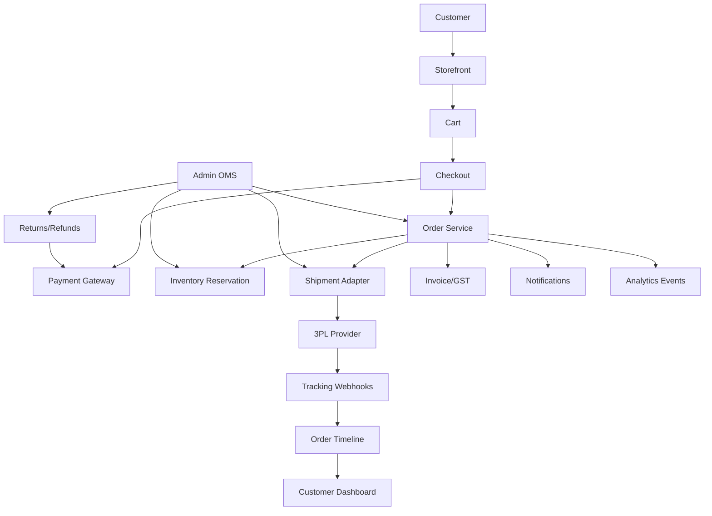

# Virasat Productization Analysis

## 1. Current State

This repository is a single-brand React + Supabase storefront with basic ecommerce flows:

- Public storefront: landing page, product listing, product detail, cart drawer, checkout
- Auth: email/password signup and login via Supabase Auth
- User area: orders, wishlist, reviews, custom design requests, notifications, profile
- Admin area: products, variants, inventory, orders, coupons, reviews, customers, custom designs
- Data layer: Supabase tables, RLS, storage bucket for product images, two edge functions

It is not yet a sellable reusable ecommerce product for clothing brands because key commercial, operational, finance, logistics, and platform modules are missing.

## 2. Verified Status

- `npm run build`: passes
- `npm test`: passes, but only a placeholder test exists
- Production bundle is large: the main JS output is ~810 kB before gzip warning handling

## 3. Key Findings

### Strengths

- Good base for a fashion-focused storefront and catalog experience
- Supabase schema already covers products, orders, variants, coupons, wishlist, reviews, notifications, profiles
- RLS exists on most tables
- Admin panel already has working CRUD for core catalog entities
- Custom design requests can become a differentiator for premium apparel brands

### Critical Gaps

- No payment gateway at all
- No shipment creation workflow
- No real live tracking integration
- No return, exchange, cancellation, refund workflow
- No invoice, GST, tax, settlement, payout, or reconciliation model
- No multi-brand or tenant-ready structure
- No CMS/content management for banners, home page sections, policies, FAQ, lookbooks
- No address book, saved addresses, guest checkout, guest cart, or order guest flow
- No E2E tests or real functional tests
- Leftover industrial/lead-generation code from another project is still present

## 4. Current Module Tree

```text
Product Today
├── Storefront
│   ├── Home
│   ├── Shop listing
│   ├── Product detail
│   ├── Search overlay
│   ├── Cart drawer
│   └── Checkout
├── Customer
│   ├── Auth
│   ├── Orders
│   ├── Wishlist
│   ├── Reviews
│   ├── Notifications
│   ├── Profile
│   └── Custom designs
├── Admin
│   ├── Overview
│   ├── Products
│   ├── Variants
│   ├── Inventory
│   ├── Orders
│   ├── Coupons
│   ├── Reviews
│   ├── Customers
│   └── Custom designs
└── Supabase
    ├── Auth + roles
    ├── Catalog tables
    ├── Order tables
    ├── Cart/wishlist/reviews
    ├── Image storage
    └── Notification + low stock functions
```

## 5. Missing Product Tree For A Sellable Apparel Ecommerce Product

```text
Sellable Apparel Ecommerce Product
├── Brand Layer
│   ├── Theme tokens
│   ├── Brand settings
│   ├── Homepage CMS
│   ├── Navigation/footer CMS
│   └── Policies/pages CMS
├── Commerce Core
│   ├── Catalog
│   │   ├── categories
│   │   ├── collections
│   │   ├── attributes
│   │   ├── variants
│   │   ├── media
│   │   └── size charts
│   ├── Pricing
│   │   ├── base price
│   │   ├── compare price
│   │   ├── tax
│   │   ├── discounts
│   │   └── promotions engine
│   ├── Cart
│   ├── Checkout
│   ├── Payments
│   ├── Orders
│   └── Returns/Exchanges
├── Fulfillment
│   ├── shipment booking
│   ├── AWB creation
│   ├── live tracking sync
│   ├── NDR handling
│   ├── RTO handling
│   └── reverse pickup
├── Customer Experience
│   ├── guest checkout
│   ├── address book
│   ├── wishlist
│   ├── reviews + media UGC
│   ├── loyalty/referrals
│   ├── notifications
│   ├── self-service returns
│   └── personalized recommendations
├── Operations
│   ├── OMS
│   ├── inventory ledger
│   ├── stock reservation
│   ├── purchase/restock planning
│   ├── customer support desk
│   ├── coupon/promo control
│   └── audit logs
├── Finance
│   ├── GST invoices
│   ├── COD reconciliation
│   ├── payment reconciliation
│   ├── refunds
│   └── margin reporting
├── Marketing
│   ├── SEO
│   ├── abandoned cart recovery
│   ├── WhatsApp/email campaigns
│   ├── lookbooks
│   ├── bundles/upsells
│   └── landing pages
├── Platform
│   ├── multi-brand readiness
│   ├── feature flags
│   ├── analytics/events
│   ├── monitoring
│   ├── backups
│   └── role-based access
└── QA/DevOps
    ├── unit tests
    ├── integration tests
    ├── E2E tests
    ├── staging env
    └── release checklist
```

## 6. Recommended Monolith Architecture

Keep it monolithic, but modular:

```text
apps/web
├── app shell + routes
├── storefront
├── account
├── admin
└── shared ui

supabase
├── migrations
├── rpc functions
├── edge functions
├── storage policies
└── scheduled jobs

domains
├── identity
├── catalog
├── pricing
├── cart
├── checkout
├── payments
├── orders
├── fulfillment
├── returns
├── crm
├── cms
├── marketing
├── analytics
└── settings
```

### Domain Rule

- UI should not write raw business logic everywhere
- Payment, order, shipment, stock, refund, and coupon rules should move into domain services or Supabase RPC/Edge functions
- Side effects should be event-driven inside the monolith: order placed, payment captured, shipment created, order delivered, return requested

## 7. Architecture Flow Graph



## 8. Delivery System Recommendation

### Recommended

Build your own fulfillment module, but use a third-party logistics provider through an adapter layer.

### Why

- Faster go-live
- Less operational risk
- Better COD, tracking, NDR, and reverse logistics coverage
- You still keep your own admin workflow and can switch providers later

### Suggested strategy

- Phase 1 default: Shiprocket or Delhivery integration
- Phase 2: abstract shipment provider interface so you can support multiple providers
- Phase 3: add direct-provider switching per brand, zone, SLA, or COD rule

### Practical decision

- If client already has a Delhivery relationship: use Delhivery direct first
- If client wants faster multi-courier onboarding and branded tracking: use Shiprocket first
- Do not build your own last-mile network; build your own shipment orchestration layer instead

## 9. Frontend Gap List

### P0

- Replace static home page content with CMS-driven banners, collections, featured sections
- Add guest cart and guest checkout
- Add proper checkout steps: contact, address, shipping method, payment, review
- Add payment UI for prepaid, COD, partial COD if needed
- Add order details page with timeline and live tracking
- Add saved addresses and multiple address management
- Add customer support/contact/ticket or help center section
- Add policy pages: shipping, returns, privacy, terms, cancellation
- Add real category/collection landing pages instead of hardcoded category cards
- Add mobile-first accessible navigation and search
- Add proper empty, error, loading, retry, and skeleton states everywhere

### P1

- Wishlist to cart
- Recently viewed
- Product recommendations
- Quick view
- Size chart per product/category from CMS
- Review submission with order verification
- Bundle offers, cross-sell, and upsell modules
- Promo banners, coupon discoverability, campaign landing pages
- Customer return/exchange request form
- Loyalty and referral UI

### P2

- Lookbook/editorial pages
- Store locator
- Gift cards
- Waitlist/back-in-stock alerts
- Social proof and UGC gallery
- Multi-language and multi-currency support
- PWA features

## 10. Backend Gap List

### P0

- Payment orders, payment attempts, webhooks, reconciliation, refund model
- Shipment table, shipment events table, courier provider logs, webhook ingestion
- Inventory ledger and stock reservation model
- Address book model
- Returns/exchanges/refunds tables and workflow
- Order timeline/event log
- Invoices, GST fields, HSN/SAC, tax breakdown
- Coupon redemption tracking and usage increment
- Admin audit log
- CMS tables for home page, collections, announcements, menus, pages
- Notification delivery adapters: email, WhatsApp, SMS, push

### P1

- Customer tags and segmentation
- Promotion engine with campaign rules
- Recommendation data/events
- Abandoned cart capture and recovery
- Support tickets and notes
- Warehouse and pickup location support
- Vendor or source-of-stock support if needed

### P2

- Multi-tenant brand isolation
- Role matrix beyond admin/user
- International shipping and tax extensions
- Loyalty points ledger
- Subscription or membership features

## 11. Required Migration Buckets

Create migrations in this order:

1. `brand_settings`, `cms_pages`, `cms_sections`, `cms_navigation`
2. `customer_addresses`
3. `payment_orders`, `payment_transactions`, `payment_webhooks`, `refunds`
4. `inventory_ledger`, `inventory_reservations`
5. `shipments`, `shipment_tracking_events`, `shipping_providers`, `shipment_webhooks`
6. `order_events`, `order_status_history`
7. `returns`, `return_items`, `exchange_requests`
8. `tax_profiles`, `invoices`
9. `coupon_redemptions`, `promotion_rules`
10. `support_tickets`, `support_notes`
11. `audit_logs`
12. `analytics_events`

## 12. Known Current Risks In Existing Code

- Checkout creates orders directly without payment authorization or capture
- Coupon validation exists, but redemption count is not updated
- Variant prices are read in cart, but order placement decrements only base product stock
- There is no stock reservation before order finalization
- Tracking is just a nullable string field, not a shipment system
- Admin order view cannot create shipment, set AWB, print label, or sync courier events
- Search is client-visible but only performs a basic product query
- Home page uses hardcoded categories and new arrivals instead of live merchandising
- Industrial lead-generation code and data remain in the repository and should be removed

## 13. Five-Agent Execution Split

### Agent 1: Frontend Commerce

- Rebuild storefront IA, checkout, account area, order detail, returns UI, CMS-driven home

### Agent 2: System Design / Architecture

- Define domain boundaries, event model, module contracts, provider adapters, data ownership

### Agent 3: Backend Commerce

- Build payments, orders, shipments, returns, inventory ledger, invoices, notifications

### Agent 4: Admin / Operations

- Build OMS, fulfillment console, promo management, CMS, analytics dashboards, support tooling

### Agent 5: QA / Automation

- Add integration tests, Playwright E2E, webhook simulations, regression suite, release gates

## 14. Suggested Delivery Milestones

### Milestone 1: Commerce Foundation

- Payment gateway
- structured checkout
- address book
- order detail page
- admin order detail
- shipment adapter scaffolding

### Milestone 2: Fulfillment + Returns

- AWB creation
- tracking sync
- NDR/RTO handling
- returns/exchanges
- invoice generation

### Milestone 3: Sellable Product Layer

- CMS
- branded tracking
- analytics
- marketing automations
- loyalty/referrals
- maintenance dashboards

## 15. Recurring Revenue / Maintenance Layer

Offer yearly AMC or monthly managed commerce operations:

- payment and shipping webhook monitoring
- catalog updates and campaign launches
- monthly CRO and merchandising changes
- order ops dashboard maintenance
- shipping/NDR/RTO optimization
- uptime, backup, incident response
- analytics and growth reporting
- seasonal landing pages and sale setup

This is the layer that creates recurring revenue for you after handoff.

## 16. Recommended Build Order

1. Clean repository contamination and remove industrial leftovers
2. Stabilize schema for payments, shipment, inventory ledger, order events
3. Implement payment gateway
4. Implement shipment provider adapter
5. Replace checkout and order management flows
6. Add CMS + brand settings
7. Add returns, refunds, and support workflows
8. Add analytics, loyalty, and growth modules

